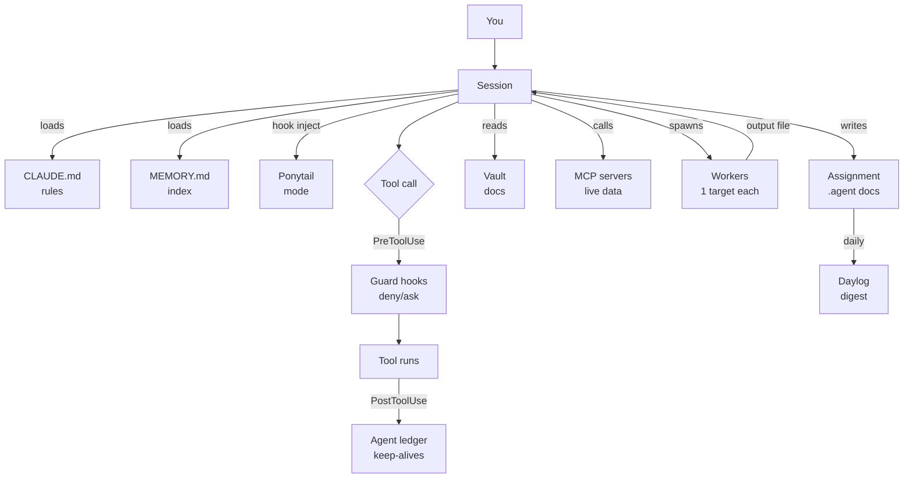

# Claude Code Setup Blueprint

A portable, company-neutral description of a mature Claude Code setup: the rules, the safety layers, memory, skills, agents and the agentic documentation workflows. Read it top to bottom once; then use the sections as recipes. Everything here was built because its absence caused a real problem. The "Why" lines keep those reasons.

Placeholders: `<VAULT>` = your notes vault (Obsidian), `<WS>` = folder holding your repo clones, `<HOME>` = `~/.claude`, `<KEY>` = a ticket key (e.g. `PROJ-123`), `<TRACKER>` = your issue tracker (Jira etc.), `<CHANGE-TOOL>` = your change-management system.

---

## 0. The whole thing on one page

| Layer | What | Lives in |
|---|---|---|
| Behaviour contract | Global rules for every session: output style, pushback, scope, subagents, model tiering, footer | `<HOME>/CLAUDE.md` (+ one per workspace / repo / vault) |
| Coding mode | "Ponytail": smallest complete change, injected by hooks into every session and subagent | `<HOME>/ponytail/` + 3 hooks |
| Safety | 3 tiers: hook **deny** → settings **ask** → settings **allow**; fail closed | `<HOME>/hooks/`, `settings.json` |
| Knowledge | 3 layers: vault (curated docs) → MCP servers (live systems) → memory (learned corrections) | `<VAULT>`, `~/.claude.json`, `<HOME>/projects/<ws>/memory/` |
| Lessons | Lessons routed to the file the next person actually reads, plus regex triggers that block known mistakes at the moment they happen | `skills/learn`, `lesson-triggers.json`, the lesson-trigger guard |
| Skills / commands | ~30 workflows: docs, handoff, review, blast-radius, debugging, TDD, learn, daily digest, tracker sync… | `<HOME>/skills/*/SKILL.md`, `<HOME>/commands/*.md` |
| Agents | Master + small single-target workers (scout, probe, investigator, builder, reviewer, env-tester, test-gate, change-packer) with a message protocol | `<HOME>/agents/`, `<HOME>/workers/` |
| Documentation | Per-assignment `.agent/` docs, versioned handoffs, evidence, a generated vault index, a daily teaching digest | `<VAULT>/Assignments/`, `<VAULT>/Ledger/` |
| Tools | Small scripts with self-tests: index generator, doc doctor, pipeline waiter, stall check, cookie vault, orphan killer | `<HOME>/tools/` |
| Backup | Private git repo snapshot with redaction + secret scan + scrubbed team export | `claude-setup/setup.js` |



📝 A session loads the rules and memory index, gets the coding mode injected, and every tool call passes the guard hooks first. Knowledge comes from the vault (designed state), MCPs (live state) and memory (corrections). Workers each take one target and return one file. Assignment docs are the durable state; the daily digest turns them into teaching notes.

---

## 1. Design principles (the "why" of everything below)

1. **Every rule is a scar.** Add a rule only after a real failure; record the event in a `Why:` line. Generic "good practice" without an event doesn't transfer.
2. **One home per fact.** Each piece of knowledge lives in exactly one file; everything else points to it. Duplicates drift and contradict.
3. **Read freely, write behind a gate.** Reads of live systems are cheap and encouraged; writes, sends, deploys and pushes need a human.
4. **Nothing leaves the machine unreviewed** (outbound gate): exact text + exact destination shown, explicit "go", then send, then read back.
5. **Prompts are weak gates.** People click "allow" without reading. Anything that must hold = hard `deny` + a deliberate unlock outside the prompt.
6. **Lessons must arrive at the moment of the mistake.** Measured: only ~6% of sessions ever opened the quirks file, and quirks recurred after being written. Hooks deliver; files alone don't.
7. **Durable state lives on disk, not in context.** Docs in `.agent/` survive compaction, restarts and new chats.
8. **Small workers, one target each, one output file each.** The master holds state, decisions and the human.
9. **Tag certainty:** proven (code/DB/log/doc) / likely (inferred) / unknown (not checked). Never claim a check passed unless it ran.
10. **Close gaps yourself.** A "Not checked:" line must never contain something you could have checked read-only right now.
11. **Smallest complete change.** Lazy about the solution, never about the change (callers, tests, fixtures included).
12. **Context budget is real.** Use tool search (deferred tool schemas: a large MCP fleet can cost ~100k tokens/turn in schemas; deferred loading cuts that by ~90%), disclose reference behind pointers, keep always-loaded files short.

---

## 2. File layout

```
~/.claude/
  CLAUDE.md                 global behaviour contract (section 3)
  settings.json             env, permissions (allow/ask/deny), hooks, status line, plugins
  engineering-principles.md design reference, read before design/refactor/review (section 4)
  performance-checklist.md  read before any perf/lag work or review of timers/polling (section 12)
  mcp-registry.md           every MCP: default on/off, when to enable, notes (section 11)
  lessons.md                cross-repo lessons, dated one-liners
  lesson-triggers.json      regex triggers for lessons (section 6)
  agent-ledger.log          one line per file write by any agent (hook)
  hooks/                    guard-rails-global.py, agent-ledger.py, role-rejoin.py, keep-alive, merge scope
  ponytail/                 coding-mode hooks, skill, on-demand docs (review/audit/debt/examples)
  skills/<name>/SKILL.md    model- or user-invoked skills (flat skills/<name>.md silently doesn't load)
  commands/<name>.md        slash commands (/docs, /handoff, /lifecycle, /cr …)
  docs/                     disclosed sub-docs (commands-docs/init|update|doctor|restructure.md, diagram rules)
  agents/<role>.md          subagent definitions (frontmatter: name, description, model, disallowedTools)
  workers/                  PROTOCOL.md, TOOLBOX.md, HANDOFF-TEMPLATE.md, sessions/
  tools/                    scripts (section 10)
  projects/<ws-slug>/memory/  MEMORY.md index + one file per memory (section 5)
<WS>/CLAUDE.md, <WS>/.claude/settings.json, <WS>/.claude/hooks/   workspace rules + project guard rails
<VAULT>/CLAUDE.md           vault guide for agents (section 8.1)
```

---

## 3. The global behaviour contract (`~/.claude/CLAUDE.md`)

Sections, each one paragraph or a few bullets. Copy the shape; replace the content with your own scars.

**Coding mode** — "Ponytail mode ON by default (full)". Hook-driven; don't restate its rules in CLAUDE.md (one home). Levels `lite|full|ultra|off`.

**Pushback rule** — Challenge decisions before executing when evidence says the approach is wrong, over-engineered, risky, poorly scoped or inconsistent with the repo (code, design, testing, product). State concern, evidence, risk, better option, and whether it's blocking. No real concern → proceed silently.

**Engineering principles** — Pointer to `engineering-principles.md` (read before design, refactors, non-trivial code, reviews). Inline summary: deep modules, no pass-through layers, DRY = one source per *knowledge*, domain names, know why code works, crash early. When a principle drove a non-obvious choice, add ≤1 sentence naming it + source; max 2 per task.

**Output style: "Adaptive Clarity"** (top priority for replies)
- Goal: easy to find, understand, use. Minimise unnecessary reading, not necessary explanation.
- Reader profile stated (e.g. "new to this codebase: explain unfamiliar terms plainly, reduce scaffolding as I show I know it").
- Certainty tag beside each claim (proven/likely/unknown); one closing `Not checked:` line.
- Condensed by default: verdict first in 1–2 sentences, then one line per point that changes action or confidence; ~150 words for a typical investigation.
- Shape chosen silently per question: fact → direct; command → fenced block with language tag at column 0, warnings before the risky step; decision → recommendation + decisive reason + blockers, pushback up front; procedure → numbered; comparison → table; investigation → findings, uncertainty, the check that resolves it; explanation → plain meaning, mechanism, example, diagram first if structure matters.
- Remove friction: state each fact once, no warm-up/echo/recap/closers, no decode-me fragments, never hide a material risk to stay brief.
- Before sending: can I find the answer without hunting? Would deleting anything change understanding, action or confidence?

**Diagrams** — Mermaid `flowchart TD` by default. Two views back to back: *Plain English* (everyday actions, real system names, no metaphors) then *Developer* (real class/queue/file names), each with a 📝 walkthrough. Labels ≤16 chars per line (`<br/>`), number key nodes ①②③, long names in a table below, one idea per diagram, style only the critical distinction. ASCII only for tiny sketches (≤60 chars wide, ≤6 lines).

**Session hygiene** — Never re-read unchanged files. Before citing a repo as current: fetch, compare with `origin/<default>`, quote the commit read. State search intent before searching. Parallelise independent tool calls.

**Subagent discipline**
- Every subagent gets a specific deliverable, never "explore and report".
- Checkpoints: stop after gathering info (before changes), after changes (before verifying), on errors/ambiguity.
- Workers append findings to their output file as they go (a dead/compacted run loses nothing).
- Delegate: multi-file exploration (5+ files), test execution, mechanical refactors.
- **Shared research once**: when 2+ workers need the same reading/decision, one scout writes a brief; each worker gets the brief path. *Why: two parallel workers read the same guidance and made opposite calls.*
- **Freeze watch**: agents can hang on an MCP call while still listed "running". After launching background agents, schedule a 10-min cron running a stall checker (transcript ends mid-tool-call + stale mtime). On STALLED: check the remote side effect → stop → re-apply from saved files. Tell agents: stop and report if an MCP call fails or hangs twice.
- **Agent ledger**: a PostToolUse hook logs every Write/Edit; "find previous work" = grep the ledger for the key/path, read that transcript.

**Model tiering** — Agent tool takes aliases only (`haiku`/`sonnet`/`opus`), not IDs. Haiku: search, listing, single-file summaries, running commands. Sonnet: multi-file refactors, tests, code from clear specs, docs. Opus (default): architecture, hard debugging, ambiguity, security, judgment.

**Output economy** — Diffs over full files. Mechanical multi-file changes: describe the pattern once, apply silently, report the count. Summarise search results. After an edit: filename + one-line change.

**Continuous learning** — Environmental failure (path, binary, flag, OS quirk) → update the quirks file before moving on, one line, replace don't append, ≤150 lines. Route first (tool gotchas → tool doc; domain facts → vault reference). Checkpoints: before handoff, after 3+ consecutive failures, on discovering a workaround (record broken path + working alternative).

**Session footer** — Every reply ends with:
```
---
**You:** <next concrete action / decision / "Nothing">
**Me:** <what the AI does next / "Waiting on you">
---
```
Rules: after a task, "✅ <task> done." + next remaining task or "All tasks complete." Decisions = 2–3 numbered self-contained options (what concretely happens + trade-off after a dash, one "(recommended)" with why). Unrelated new topic → suggest a fresh chat with a one-line catch-up prompt. Never invent follow-up busywork.

**Performance work** — Pointer: read `performance-checklist.md` first; measure before reading code.

**Long-running commands** — Anything that keeps printing (logs, servers, watchers) runs in the background; tell the user where to watch it. Never secrets on a watched command line. CI pipelines: never poll with tool calls; run a background waiter script that exits on finish (re-invokes you for free).

**MCP on demand** — Disabled MCPs' tools are invisible, so a registry file lists them. Need one that's off → one line `🔌 Enable <server> via /mcp — needed for <reason>` and wait; don't work around it with weaker tools. Done → say it's safe to disable. Cluster logins: check `whoami` per cluster before asking the user to log in; never print tokens.

**Vault-backed teaching** — The vault is the primary domain source; use it for assignments, not only teaching. Navigate via the generated index, then topic hubs, then grep. Cite note + section. **Subagents don't inherit this: put the vault path and entry files in every subagent prompt.** Route non-vault questions: org standards → org knowledge base skill; internal tool how-tos → internal docs MCP; team wikis → wiki REST; email/chat/meeting evidence → offload (section 7.6).

**Skill overlap rules** — When several skills match, pick the most specific (e.g. "debug/investigate" → diagnosing-bugs; known fix + tests first → tdd; "review my MR" → review, which already covers impact; "remember this" → learn; agent-facing doc → writing-for-agents; human-run script → wizard).

**Ticket tangent tracking** — While on a ticket, watch for out-of-scope work (bugs, CVEs, tooling fixes, helping others, deferred follow-ups). One line once per tangent: `🎫 Tangent: <desc> — outside <KEY>. 1) note on parent (recommended: <why>) · 2) new issue · 3) keep local?` Never create without approval. When a session produced commits/MRs/decisions not yet in the tracker, add one line after the footer: `🔄 <TRACKER>: <KEY> — this session's work isn't there yet → /tracker-sync <KEY>`.

**Org-process nudges** — A table "you notice X → suggest skill Y" (requirements, design, threat model, tests, onboarding to a codebase, release readiness). One `Tip:` line, once per session per skill, never auto-invoke, never for quick fixes.

**Offload** — Proactively hand expensive synthesis or evidence that lives in email/chat/docs to a second assistant via a versioned handoff file (section 7.6). Don't offload small or repo-local work.

---

## 4. Engineering principles reference (`engineering-principles.md`)

Load when designing, refactoring, writing non-trivial code, reviewing. **Precedence:** safety/correctness > user instruction > repo conventions > minimal scope > this file.

- **Complexity (Ousterhout):** complexity = dependencies + obscurity. Deep modules (interface much simpler than implementation); shallow wrappers/pass-throughs are smells. Information hiding: one module per design decision; two modules knowing the same format/ordering = leakage. Split by knowledge, not execution order. Pull complexity down. Define errors out of existence where safe, never for money/security/data loss. Design it twice for non-trivial interfaces. Comments: interface = contract/units/invariants; implementation = why. Vague names (`data`, `manager`) = unclear design.
- **Pragmatic (Thomas & Hunt):** DRY is knowledge, not text. Orthogonality. Reversibility (isolate vendor choices). Tracer bullets. Don't program by coincidence ("cause unknown" if unknown). Crash early. Design by contract. Whoever acquires a resource releases it. Broken windows: fix in scope, flag out of scope.
- **Brooks:** conceptual integrity (consistent ordinary code beats inconsistent "better" code). Make requirements explicit incl. non-goals. Find the scarce resource. Use precedents in the repo. Record rationale.
- **Evans (DDD):** ubiquitous language from tickets/docs; bounded contexts; anti-corruption layers at legacy boundaries; value objects over entities; aggregates; domain logic out of controllers/consumers/DAOs; no tactical DDD for CRUD glue.
- **Beck (XP):** simple design (passes tests, reveals intent, no duplicated knowledge, fewest elements). YAGNI. Bug fix → failing test first. Refactor only touched code with tests green. Small batches.
- **Tensions:** strategic vs smallest change → smallest scope, strategic quality inside it. DRY vs orthogonality → don't merge code encoding different rules. Deep modules vs YAGNI → depth hides today's complexity, doesn't add tomorrow's features. Convention vs principle → follow convention, flag the violation.
- **Inline rationale:** ≤1 sentence: what + why here + (source). E.g. "Kept the topic name in config only — single source of knowledge (Pragmatic, DRY)."

---

## 5. Memory system

**Format** (one fact per file):
```markdown
---
name: kebab-slug
description: one line; decides relevance at recall time
metadata:
  type: user | feedback | project | reference
---
<the fact>
**Why:** <the event that caused it, dated>
**How to apply:** <what to do differently>. Related: [[other-slug]]
```
`MEMORY.md` = index loaded every session, one line per memory: `- [Title](file.md) — hook phrase`. The hook phrase says **when** it applies ("before any DB query on big tables"), not what it contains. Budgets: index lines ≤120 chars / ≤50 lines; memory file ≤30 lines / 2.5 KB.

**Don't store:** what the repo, git history or CLAUDE.md already holds; one-conversation facts; secrets (store *where* to get them and *how* they're passed, never values). Wrong memory → delete or update, never add a contradicting one. Memories are point-in-time: verify file/flag names before recommending.

**Types in practice:** `feedback_*` (most valuable: user corrections), `env-quirks` (machine/CLI dead ends), `reference` (pointers: URLs, consoles, which tool for what), `project` (time-bound facts with absolute dates), `user` (identity, expertise, learning style).

### 5.1 Feedback rules worth copying (generalised)

| Rule | Why (event) |
|---|---|
| **Outbound gate:** draft exact content + exact destinations, stop for "go", never batch-fire sends in parallel; a general "send it" doesn't approve specific content | Comments got posted to the wrong issues |
| **Scope before action:** a folder/list isn't a target list; present the inferred set and ask "these N — correct?" | Acted on every file in a folder; user meant two |
| **Commit/push split:** the AI commits after approval; the human pushes. If a hook blocks the commit, hand over staged files + message file + exact commit/push commands at once. Never fake an approval marker | A blocked commit became a two-round detour |
| **Local-first ladder:** compile + tests → container build (mandatory if a Dockerfile exists) → commit/push → CI lower env → promote | Packaging bugs only surfaced in CI |
| **Agents never write tracker fields:** workers write the full new text to a draft file and return `needs-approval` | Tracker update calls with no timeout froze several agents for most of an hour |
| **Close gaps proactively:** follow the change one hop downstream and one environment sideways by default | Reported two gaps that each took minutes to close |
| **Evidence = key-line excerpts** (~40 lines, secrets grepped out) + summary; raw logs stay outside the vault | Many MB of raw pod logs copied into the notes vault |
| **Live production read is a snapshot, not a fact:** re-read on the day you rely on it, on every cluster; separate desired vs ready replicas; confirm with an independent signal; compare live prod with the release's values and flag every diff the deploy would change | A stale snapshot almost went into a change request as the live state |
| **Release version = latest git tag** on the release branch, not chart/pom versions; what prod *runs* = query the cluster | Chart and pom versions were decoupled from releases |
| **Change-request draft first:** every field's final text + before→after + attachment list, user approves, publish, read back | Fields patched straight from a script went live unseen |
| **Always reconcile after writes:** read back every external write; "success" lies (wrong type silently rejected, read-only field) | A tracker call returned success; the field stayed empty |
| **Verify API field names** against the real response or source; huge result sets hint at an ignored filter field | REST APIs silently ignore unknown fields |
| **Test runner ≠ system under test:** a harness passing proves the harness's config, not the target's | A suite's own truststore was checked instead of the service's |
| **Drive web UIs via their REST API with curl:** reads directly, writes after approval; never secrets on the command line | Handing the user click-steps was slower and hid the real error |
| **Paste-ready commands:** full URL, every flag, namespace, which terminal | Shorthand stalled a less experienced user |
| **Version-prefix file names** `v1_`, `v2_`, `v2.1_` (sort order) | Suffix versions scatter in file explorers |
| **Dependencies only from the company package mirror:** pin, inspect install scripts, smoke-test; not there → no download | Sanctioned source; supply-chain risk |
| **CVE upgrades stay in the same major;** no same-major fix → stop, flag, ask. Report only pipeline-blocking severities if that's the team's bar | Major jumps drag breaking transitive changes |
| **DB guardrails:** big tables = filter on the leading indexed column + row cap, one query at a time, no leading-wildcard LIKE | Unbounded scans on very large tables |
| **Env cleanup after any deploy/test:** list pods/replica sets on every cluster; anything not ready is your mess, even if "pre-existing"; give the exact scale-down command | Stuck pods held namespace quota for 2 days and blocked a teammate |
| **Duplicate search before drafting a new ticket** (incident number, job names, class names, last 180 days) | Two duplicate tickets were created |
| **Split tickets sequentially:** draft all, publish one, finish, close, next | All-at-once fills sprints with unstarted work |
| **Short ticket titles** (~70 chars: problem + where) | Sentence-length titles rejected |
| **Fan out independent asks:** several independent requests = one subagent each (own worktree/branch); master briefs, reviews, merges | Juggling 6 requests alone |
| **Clean test artifacts:** probe sessions in a throwaway cwd, close test windows in the same command that reads their result, delete test profiles | Test runs polluted history and popped windows over the user's work |
| **Prompts are blindly accepted:** design deny + deliberate unlock for anything that must hold | User confirmed clicking without reading |
| **Scope gate MRs tightly:** fix what reviewers mark must/should; skip drive-by edits | Extra sections cost review rounds |

### 5.2 Environment quirks file

One file, ≤150 lines, grouped: Shell & runtime, fork errors, path conversion, heredoc/escaping, CLI & sessions, auto-mode classifier denials, permissions & hooks, tools & dead ends. Each line: broken approach → working alternative, dated. Universal Windows + Git Bash entries worth pre-seeding:
- `python3` may be the Store stub → use `python`; run scripts with `python -I`; set `PYTHONUTF8=1`; `open()` defaults to cp1252 and CRLF → pass `encoding='utf-8'`, `newline=''`.
- Git Bash rewrites `/`-leading args to native exes → `MSYS_NO_PATHCONV=1` (e.g. `explorer.exe "/select,<path>"`), or double slashes (`taskkill //PID`). Paths *inside* `python -c` strings are not converted → use `C:/...`.
- Never pass code containing `\`, `\n`, backticks or `${}` through heredocs/`-e`; write a file with the Write tool.
- Fork errors (`0xC0000142`, `fork: retry`) = desktop-heap/process leak, not your code → find and kill orphans; run test loops from one node process.
- PowerShell from bash with `$_`/pipes dies → write a `.ps1`, run with `-NoProfile -ExecutionPolicy Bypass -File`.
- `git worktree remove` fails if your shell's cwd is inside it; junctions inside worktrees must be unlinked first (never `rm -rf` a dir with junctions).
- HAR exports strip cookies → copy the Cookie header from a single request in DevTools.
- Skills must be `skills/<name>/SKILL.md`. `--output-format stream-json` needs `--verbose`. The session id env var is `CLAUDE_CODE_SESSION_ID`.
- Any Bash command whose *text* contains "git push" trips a push-blocking hook even inside an echo → write such notes with Write/Edit.

---

## 6. Lessons system (record → route → trigger → measure)

`/learn record` steps:
0. **Worth saving?** Name the event in this session it prevents (no event → don't save). Cover the class, not the instance ("would the next slightly different case still match?"). One lesson per entry.
1. **Pick the home** (first match wins); grep it; REPLACE an existing entry rather than append:

| Lesson is about | Home |
|---|---|
| Driving a tool/MCP/web app (API, auth, gotchas) | Vault `Reference/<Tool> MCP.md` |
| How workers should use a tool | `workers/TOOLBOX.md` (process → `PROTOCOL.md`) |
| A test-gate tool | Its playbook's lessons section |
| Machine/CLI/OS quirk | memory `env-quirks.md` |
| A skill's own steps went wrong | That `SKILL.md` |
| System/domain/runbook fact | Matching vault `Reference/` note |
| User preference or correction | `feedback_*.md` + index line |
| One repo's code/build | `<repo>/.agent/lessons.md` |
| Anything else cross-repo | `~/.claude/lessons.md` (`- [YYYY-MM-DD] <lesson> - Why: <rationale>`) |

2. **Write it** in the home's style; delete superseded text in the same edit.
2b. **Add a trigger** (required for quirks; any lesson visible in a command or its output) to `lesson-triggers.json`:
```json
{ "id": "python3-stub", "added": "YYYY-MM-DD", "where": "cmd", "action": "block",
  "regex": "(^|[;&|(]\\s*)python3(\\s|$)",
  "fix": "`python3` is the Store stub. Use `python`.",
  "home": "~/.claude/projects/<ws>/memory/env-quirks.md", "anchor": "`python3` = Store stub",
  "examples": { "hit": ["python3 -c 'print(1)'"], "miss": ["python run.py", "grep \"python3 \" notes.md"] } }
```
`cmd`+`block` only when the command is always wrong (the lesson-trigger guard blocks it and prints `fix`; an inline `# lesson-ok:<id>` overrides). Otherwise `out`+`track` on the exact error text. Run `lesson-report.py --selftest` (every regex compiles, examples hit/miss, anchor still present in its home).
3. **Pointer only if needed:** add a MEMORY.md pointer only when the home isn't auto-loaded or already referenced.
4. **Report:** one line per file: `replaced <topic> (net -N lines)` / `added (+N)`, plus trigger status.

Other subcommands: `promote` (lesson seen 2+ times or costly → one-line CLAUDE.md rule, ask first, mark `[promoted]`), `prune` (dupes/stale, ask first), `doctor` (read-only walk of the memory graph from MEMORY.md, 2 hops: over-budget files, same fact in 2+ homes, contradictions, dangling links, stale dated facts (>14 days beside an uncertainty word), orphans; end with a compress plan and "apply?").

`lesson-report.py [--days 30]` measures per trigger from transcripts + hit log: working, not working (repeated after block → rewrite fix), noisy (≥2 overrides → narrow regex), broken (anchor gone), recurring-not-delivered (make a cmd trigger), dormant. Basis: a 2026 study finding lessons only help when loaded at the moment and covering the instance.

---

## 7. Skills and commands catalog

Each entry: trigger → what it does → the rule that makes it work. Model-invoked skills keep a `description` (always-loaded cost, discoverable); user-invoked ones set `disable-model-invocation: true` (zero context cost, you are the index).

### 7.1 Documentation workflows (core)

**`/docs`** — per-assignment documentation that persists across sessions. Subcommands: `init <name>`, `update`, `status` (CONTEXT in full, file list, blockers, last 5 progress rows, handoff count, one-line summary), `find`, `restructure`, `doctor`. Details in section 8.

**`/handoff`** — only when moving work to a new chat. Steps: identify assignment (remotes, keys, paths, else ask) → no `.agent/` → run `/docs init` first → run `/docs update` logic → write `handoffs/vNN_<PascalSlug>.md` (target <2 KB, ceiling 3 KB; slug from session title) → output the continuation prompt:
```
Read the assignment docs at <A>/.agent/CONTEXT.md, then the latest handoff at <A>/handoffs/vNN_<Slug>.md. Continue the work in "What Remains". The previous session's decisions are authoritative — don't revisit them unless clearly wrong.
```
Handoff template: Session Summary (goal; trigger) · What Changed (grouped) · What Remains (ordered, gotchas) · Git State (repo, branch, last commit, uncommitted) · Session-Specific Context (omit if empty). Handoffs persist as history.

**`/daylog [date|FROM..TO] [--mail]`** — daily teaching digest. Section 8.4.

**`kb-extract-lite`** — token-cheap phased codebase→knowledge-base extraction (≈10× cheaper than a one-shot extractor). Menu of phases, each ≤25 tool calls, state in `<repo>/.kb-extract/state.json` for resume: 0 Setup (resolve KB path: config → env var → sibling dir → home; read the KB's index, templates and standards) · 1 Overview (README, build, Docker, CI) · 2 API surface · 3 Data model · 4 Integrations (clients, queues, retries; cross-check resilience standards, flag deviations) · 5 Security · 6 Config/deploy · 7 Questions to the human (business purpose, ownership, status, known issues, sensitivity) · 8 Draft (system overview, integrations, decisions, standards gaps; user reviews) · 9 Publish (branch, files, index, bidirectional links, commit, MR). Confidence: High (code), Medium (user), Low (inferred). A guard hook blocks the expensive one-shot extractor and points here.

**`/learn`** — section 6. **`/scan-env`** — scan this session for environmental failures, compare with the quirks file, route each new one via the learn table, replace don't append, keep ≤150 lines; "nothing new" if all documented.

**`/title`** — suggest a 3–8 word session title; group into chains by ticket key → assignment → topic: `<KEY> (N) - <title>`. A log of kept names lets it count the chain.

**`/eli5 <topic>`** (user-invoked only) — interactive lesson: ground in the vault silently → diagnose with 2–3 questions + a one-line guess, then stop → name 3–6 parts → explain each simple→technical (plain meaning, name, why it exists, cause→effect steps, common failures, why it matters to my work, real file:line) → make me think (why/predict/explain-back; don't answer in the same message) → feedback (hint, one retry, explain) → close (3-bullet summary, 2 check questions with hidden answers). Stop words: "done", "skip"; off-topic pauses the lesson. Saves full lessons to `<VAULT>/Learning/Impromptu/YYYY-MM-DD <Topic>.md` + index row; spaced repetition via a log (`date | topic | key idea | weak spot | note`), one recall question on a >2-day-old weak spot at each lesson start; `/eli5 review` quizzes 3–5 mixed items. "Urgent" → answer first, teach briefly.

### 7.2 Review and quality

**`review`** — review an MR/branch/commit/diff like the dev who gets paged. Read-only. Scope → understand (callers of every changed function, data in/stored/out, load) → **blast-radius gate** (recommend when the change writes a DB column/message field differently, renames a config key/queue/column/API field/enum/public method, touches shared pipelines/charts/secrets, or changes a shared library; ask once, wait) → look for, in order: bug, risk (security, data loss), unneeded change (renames, reformatting, drive-by refactors; a rename of something another system reads is a **bug**), missing/hollow test, scale, lean (dead code, existing helper, one-use abstraction, knowledge duplicated) → check (every finding has "this input → this wrong result"; no "consider") → output:
```
What this change does: <2–3 sentences incl. the non-obvious part>
🚫 Must fix / ⚠️ Should fix / 💬 Nice to have  (numbered across groups)
2. **<problem>** (`file:line`)
   - Problem: <case → wrong result>
   - Fix: <smallest; often "revert this line">
   - Proof: RAN IT | READ IT | GUESS — <why>
Blast radius: ran / not needed (why) / skipped by user
Verdict: ✅ Ship · ⚠️ Ship after nits · 🚫 Fix <n> first   (never ✅ with an open Must)
Lean: -<N> lines possible.   Not checked: <…>
```
A repo-root `CODE_REVIEW_PROMPT.md` overrides defaults.

**`blast-radius`** — find what a change breaks *outside the diff* and prove the one fact it's safe because of. Proof ladder: 1 said so (worthless) → 2 pointed at the line → 3 walked the failure, it can't reach → 4 ran a script calling the real code → 5 reproduced in the running app. Steps: load the system's context pack (stores, queues, readers, traps; a checker script validates the pack's anchored facts against fresh repos and flags STALE/MISSING) → read the change incl. what it now does differently → find the single safety fact → look where grep stops (library source at the pinned version, timing/teardown, JSON returned, DB columns, wire formats, other languages reading the same bytes, flags, code 3 hops downstream) → **data you write (mandatory):** for each column/field whose value can differ, run a readers scanner across all cloned repos' default branches and read *how* each reader uses the value (exact equals, contains, switch, parse, length); each reader condition becomes a writer-side test → honest risks with probability and cost, cleared list separately → prove the fact with a script → for big changes, ask multiple models and merge. *Why: appending text to a "free-text" column broke a downstream reader that matched the exact value; unit tests, coverage gate and UAT all passed.*

**`diagnosing-bugs`** — 1 build a fast deterministic feedback loop that goes red on *the user's* bug (don't proceed without it) → 2 reproduce + minimise (cut one element at a time until every remaining element is load-bearing) → 3 3–5 ranked falsifiable hypotheses ("if X, then changing Y fixes it"), show the user before testing → 4 instrument one variable at a time, debugger > targeted logs, tag debug logs `[DEBUG-a4f2]`; perf: baseline then bisect → 5 regression test at a *correct seam* before the fix (no correct seam = a finding) → 6 cleanup checklist (repro gone, test passes, tags grepped out, prototypes deleted, correct hypothesis in the commit message). Redact secrets in everything shown.

**`tdd`** — tests through public interfaces only; agree the seams with the user before writing any test; anti-patterns: implementation-coupled, tautological (expected value computed the way the code does), horizontal slicing (all tests first); vertical slices (one test → one minimal implementation → repeat); refactoring belongs to review, not the loop.

**Ponytail family:** `/ponytail lite|full|ultra|off`; `/ponytail-audit` (read-only whole-repo audit: map first, find expected load, ≤20 findings, each with What/Problem/Fix/If-we-skip-it); `/ponytail-debt` (ledger of every `shortcut: <ceiling>, <upgrade trigger>` comment plus TODO/FIXME/suppressions; flag markers with no trigger as rot risk); `/ponytail-gain` (benchmark scoreboard).

### 7.3 Thinking and communication

**`grilling`** — interview the user as a design tree: each round asks the whole *frontier* (decisions whose prerequisites are settled), numbered, each with your recommended answer worded so "yes" accepts it. Facts are your job (dispatch a subagent; don't block other questions); decisions are theirs. Done when the frontier is empty and they confirm shared understanding.

**`to-questionnaire`** — turn a decision you can't make alone into an async Markdown questionnaire for the person who holds the knowledge. Interview the sender only (who's it for, what do you need back), then write: Purpose, From/To/How answers are used, Context paragraph, How to answer (deadline, "I don't know" is useful), themed sections, most important first, one idea per question, answer stub, optional *why this matters*, closing "Anything else?".

**`ketchup`** — catch the user up since their last message: read-only; open with the count of action items; then what happened, most important first, with what it means; then each action item as an executive summary (decision, why now, options + cost, recommendation, what happens if unanswered). Use names the user knows.

**`unslop`** — remove AI tells from prose (content, language, style, filler, jargon patterns in a reference file).

**`writing-for-agents`** — reference for any doc an agent consumes. Key ideas: a *context pointer* (skill description, a CLAUDE.md line) decides when material is reached — sharpen the pointer before inlining. Front-load the leading word; one trigger per branch. Two loads: context load (always-loaded tokens) vs cognitive load (the human is the index). Hierarchy: in-file step → in-file reference → disclosed reference behind a pointer; inline what every branch needs. Every step ends on a checkable, exhaustive completion criterion. Split by sequence (when later steps tempt rushing) or invocation. Leading words recruit priors (*tight* loop, *red*). Prompt the positive; negation makes the banned behaviour more available. Prune no-ops sentence by sentence.

**`wizard`** — generate an interactive bash script for steps only a human can do (provisioning, credentials, CI secrets, dashboards, cutovers): scope stages from the repo (env files, CI variable refs) and confirm → map each stage's exact journey (never invent UI steps) → script with `stage`, `open_url` (cross-platform incl. WSL), `ask`/`ask_secret`, idempotent `write_env`, `set_secret`/`set_var`, `confirm` before irreversible steps, progress counter, screen clear per stage → `bash -n`, shellcheck, trace statically, don't run it.

### 7.4 Tracker and release workflows

**`/tracker-sync [KEY…]`** — keep the tracker in step with real work. Window per issue = since my last comment carrying an anchor `{anchor:jsync-<UTC>-<hash of source IDs>}` (else issue creation, capped 30 days). Evidence (read-only): git commits across all clones (fast scanner), MRs by me, issues I created, assignment PROGRESS rows incl. `[tangent]`/`[note]`, a local notes file. Dedupe (commit inside an MR counts under the MR). Unmapped evidence → ask (attach / new issue / keep local). Draft one comment per issue in the tracker's markup: dated headline, brief, Status ladder words **only from evidence** (commit = implemented, test run = tested, merged, pipeline record = deployed, evidence file = verified), Additional scope, Blocker (owner), Decisions, Impact (verified only), Next, anchor. Redaction check (secrets, local paths). Show drafts, accept `post 1,3` / `edit 2:` / `skip`. Publish: re-fetch, skip if anchor present, post, re-fetch to confirm; on timeout re-fetch before retrying (idempotent). `/tracker-sync note <KEY|-> <text>` records non-git work.

**`/tracker-tangent`** — route side work by scope: 1) note on parent (needed to deliver the parent) → `[tangent]` PROGRESS row; 2) new issue (independent, other owner, deferred) → dedupe search, draft (type, ≤80-char imperative summary, Context/Problem/Done when/Evidence), create on approval, link "Relates", copy parent's feature/labels + `tangent`; 3) keep local. `log` subcommand = year-end table of tracked work with tangents grouped.

**`/lifecycle <KEY>`** — run a ticket as master + workers, intake to release. Section 9.

**`/change-request [assignment] [ID]`** — build a change-request pack: read the process note, runbook, team conventions and a worked example first; hard rules: draft only, only sourced facts (`<TODO: what's needed>` otherwise), release version = git tag, blast-radius gate if a DB column/message field is written differently. Gather in parallel (tags, chart versions, MRs, pipelines, namespaces, verification rows from PROGRESS, people). Write `CR/vN_cr-fields.md` with one section per field of your change form, in form order (summary, description, justification, implementation plan, risk per change, backout, test plan + outcome, post-implementation checks), plus `vN_release-details.md` with one `## <Sheet>` table per sheet your process needs, and the testing evidence file. A converter script turns the Markdown into `.xlsx`/`.docx`. Evidence README lists every file and when to upload it. A CR with fields but no attachments is not done. Report TODO count by field and the lead-time check.

**Release traceability check** — a script calls the traceability tool's API with the user's browser session cookie (stored in a file, never echoed) for many repos at once; prints GREEN/RED per ticket key and the report link to attach to the test plan. Reds get fixed in the tracker, not explained away.

**Test-coverage gate:** if your org has one, treat any finding as a fail (no "pass with warnings"); save reports per scope; attach curated evidence to the **test plan**, not the story; after a clean run, run the traceability check before the CR.

### 7.5 Utility commands

`/path <path>` (open Explorer; `MSYS_NO_PATHCONV=1`, `/select,` for files, append `; true` because explorer exits 1) · `/offload` (7.6) · `/ketchup` · `/title`.

### 7.6 Offload to a second assistant

Triage first: refuse if small/mechanical, context already sufficient, or the handoff costs more than the task. Classify: standard (synthesis, architecture/security/migration review, approach comparison, stakeholder docs) or evidence referral (email, chat, meetings, shared drives, org info). Gather evidence tagged PROVEN / INFERRED / UNKNOWN. Write `<repo>/docs/offload/<topic>/vN_<name>.md` (never overwrite): Model, Requested outcome, Context (minimum), Evidence (3 tags), Current proposal, Questions, Constraints, Expected response format; referral adds sources, exact keywords, people, date range, questions. Report path + model + 2–3 evidence bullets + a paste-ready instruction. Stop reasoning-heavy work until the response comes back.

---

## 8. Agentic documentation workflows (in depth)

### 8.1 The vault and its agent guide

```
<VAULT>/
  CLAUDE.md            agent guide: find order, layout + trust table, assignment folder order, rules
  _MOCs/Agent-Index.md GENERATED: every folder's note titles + one row per assignment (type/status/key/next)
  _MOCs/Home.md        → topic hubs (one Map Of Content per system/area)
  Knowledge/           curated domain + architecture, numbered sequences (00-…10-) read in order   trust: high
  Reference/           how-tos, runbooks, tool/MCP notes, playbooks                                  trust: high
  Learning/            learning path, glossary, Impromptu/ (eli5 lessons), concept register          teaching
  Assignments/YYYY-MM-DD <Name> (KEY, KEY)/   per-assignment work                                    current
  Ledger/YYYY-MM-DD/   daily digest: 00 Overview + one chapter per workstream                        point-in-time
  Meetings/YYYY-MM-DD <topic>.md                                                                     point-in-time
  Archive/, Daily Notes/                                                                             stale: never cite as current
```
Find order for agents: 1) generated index, 2) Home → topic hub, 3) grep only for a term the index can't resolve. Rules: never hand-edit the index (regenerate with `vault-index.js`); `v1_` prefixes; absolute dates; `[[wikilinks]]`; report links that need updating when moving notes. Document what's team-specific (conventions, decisions, business rules, system interactions, deploy quirks), not what changes daily (use live MCPs), lives in code, or is generic knowledge.

### 8.2 Assignment folder

```
<Assignment>/
  .agent/            durable agent state (Obsidian hides dot-folders)
    CONTEXT.md       current state only (no history, no task lists) — read first
    PROGRESS.md      chronological log (newest at bottom) + Verification table + Remaining Work table (mandatory)
    BLOCKERS.md      active blockers only (resolved → PROGRESS)            — only if any exist
    DECISIONS.md     non-obvious decisions; prune once self-evident in code — only if any exist
    INVESTIGATION.md findings table, open questions, methodology          — investigation/remediation
    ARCHITECTURE.md  overview, stack, data flow, interfaces               — build/migration
    RUNBOOKS.md      procedures: when, steps, verification                — process work
  agent/             read-only MIRROR of .agent/ so Obsidian shows it; copy after every .agent write, never edit
  handoffs/          vNN_<Slug>.md (highest = latest); AGENTS.md registry + MASTER-INBOX.md when workers run
  evidence/          YYYY-MM-DD_<check>.md: commit, environment, command, assertions, result, limitations; excerpts only
  scripts/ notes/ briefs/ attachments/ misc/ CR/ testgate/   created only when needed
```
Classification at init (can be several): investigation (recon, audit, findings) · build (code, MRs) · process (renewals, onboarding, coordination) · remediation (secret removal, security fix, history rewrite) · migration (platform/tech swap) · complete (core files only). Budgets: `.agent/` ≤6 KB combined, handoff ≤3 KB. Folder name carries its keys; a rename script appends keys and rewrites every path reference (dry run first).

**CONTEXT.md template**
```markdown
# Context — <Assignment>
## Identity
- **Key**: <KEY(s)>  - **Type**: <classification>  - **Status**: active|paused|done  - **Started**: <date>
- **Phase**: <lifecycle phase>  - **Workers**: <role target → name>  - **Next**: <one line>
## Repositories
| Repo | Branch | Remote URL | Notes |
## People
| Name | Role | Notes |
## Key Paths
- Vault: <abs path>   - Code: <path>
## Tools & Access
## Scope Summary
<1–3 lines>
```
**PROGRESS.md template**
```markdown
# Progress — <Assignment>
| Date | Entry |
|------|-------|
| <date> | /docs init — classified as <type>, scaffolded |
## Verification
| Check | Status | Evidence Link | What It Proves | Gaps |
## Remaining Work
| # | Task | Status | Blocker |
```
Verification status: `proposed` → `executed` → `passed`/`failed`, or `stale` (code/config changed since the evidence). Each progress entry states the outcome plus its proof or what it ruled out ("fix deployed — errors continue, so not the only source"), because the daily digest reads these rows.

### 8.3 `/docs` subcommands

- **init**: fuzzy-match the folder (else list and ask) → stop if `.agent/` exists → classify → scaffold only warranted files (no empty files) → populate from existing briefs/notes/handoffs, mark guesses `(inferred)` → **tidy loose root files** by pattern (briefs/specs → `briefs/`, notes/meetings → `notes/`, handoffs → `handoffs/`, binaries → `attachments/`, findings/dry-runs/checkpoints → `evidence/`, rest → `misc/`; never move directories; show a move table and get Y/N; ask if <3 files; report wikilinks to fix) → report classification, files created/skipped, moves, blank fields.
- **update**: read all `.agent/` files → gather from session activity *and* the whole conversation (retroactive facts: URLs, people, blockers, decisions) → additive, no duplication (CONTEXT edit in place; PROGRESS append + always refresh Remaining Work; create BLOCKERS/DECISIONS/etc. the moment content exists) → **stale-evidence check** (passed/executed rows whose relevant files changed after the evidence date → `stale`) → size discipline (merge old PROGRESS rows by week, trim self-evident decisions, summarise resolved findings) → regenerate the vault index → copy `.agent/` → `agent/` → report one line per file + the tracker-sync reminder.
- **restructure**: re-classify, audit files/dirs vs recommendation, plan (`.agent/` moves, new dirs, file moves), confirm, apply — never delete.
- **doctor** (read-only): a script checks budgets, `.agent/`↔`agent/` drift, header-only files, repeated facts across files, dangling links, stale open items (>14 days), history lines in CONTEXT, done rows in Remaining Work, missing Remaining Work; the agent then checks live state (every MR/ticket/CR named as open), contradictions with cited vault notes, reusable how-tos that belong in `Reference/`, vault facts copied in (replace with links), superseded sections (→ `handoffs/archive/`). Writes `evidence/vN_<date>_docs-doctor.md` with a compress plan (bytes saved per edit), asks "apply?".

Rule from use: `/docs update` keeps CONTEXT `Next:` current so any new chat resumes from `.agent/` alone; `/handoff` only when actually switching chats (a handoff per update duplicated PROGRESS).

### 8.4 Daily digest (`/daylog`)

Purpose: a lot of parallel agent work gets lost; the digest tells what was done **and teaches it** the way a senior engineer understands it, written for a beginner. A day runs 16:00→16:00 (a scheduled task runs `claude -p "/daylog --mail" --model sonnet` at 16:00 with a narrow `--allowedTools` list, logging to a file).

Master: `day-digest.py [date]` compacts the day's transcripts + agent ledger (per session: title, prompts, last reply per turn, files written) → write a grouping plan (workstream = an assignment, or several sharing a problem/system/release; all tooling work = one note; 3–7 notes; never drop a session) → delete any previous output for that date (clean rebuild) → one writer agent per workstream in parallel → write `00 Overview.md` (one sentence on the day, table `Workstream | Key | Today in one line | Status`, New concepts, Waiting on; ≤40 lines), append concept-register rows (dedupe; second teacher becomes "seen before" link), append one `LEARNED.md` line per assignment, regenerate the index → optional email to self (Markdown → phone-friendly HTML attachments).

Writer chapter format (5–10 min read, a few connected ideas taught well):
```markdown
## <Descriptive topic title>
### The problem        what should have happened, what did, why it mattered, where it sits
### How the system works   only the needed background; small flows (A → B → C)
### What went wrong    technical evidence: IDs, jobs, classes, commands, numbers; show bug behaviour
                       (Expected / Old code / Fix lines)
### The fix            **Confirmed** / **Likely** / **Open** (who would answer)
### What I should learn from this   2–4 reusable lessons, 1–2 sentences each
### Key terms          few, one line each; already taught → "Seen before: [[link]]"
```
Writing rules: full sentences like a senior colleague; define every acronym on first use in each note; explain the why; facts only from transcripts and vault ("unclear from the chat" otherwise); no secrets.

### 8.5 Other documentation outputs

- **Evidence files**: `vN_<env>-<check>-excerpt.log` + summary; exact query, time window, env; raw logs in a temp folder outside the vault.
- **Worker outputs**: `vN_<role>-<target>.md` with the 10-line top block (section 9.3).
- **Change packs**: `CR/vN_*` Markdown → generated Office files in `CR/evidence/`.
- **Lessons** (eli5): `Learning/Impromptu/` + index + spaced-repetition log.
- **Offload handoffs**: `docs/offload/<topic>/vN_*.md`.
- **Generated notes** from scanners (e.g. "shared DB tables and topics touched by 2+ repos", with `--check` to detect staleness).
- **Doc-style index** (`DOCS-STYLE.md` in the backup repo): one page that points to the single source of each writing rule (replies, diagrams, vault, tracker, CRs, messages).

---

## 9. Master + worker agents

### 9.1 Roles (one instance = one target)

| Role | Started by | Model | Target | Does | Never |
|---|---|---|---|---|---|
| scout | master (Agent tool) | haiku | 1 ticket+links / vault topic / repo | Facts: what, owner, state, related tickets/MRs, key `file:line`. Done when master can act without opening sources | Change anything, diagnose |
| probe | master, any phase | sonnet | 1 live source × 1 env | Answer one question ("did offsets N+ get consumed?"); save excerpt with exact query/window/env | Publish, deploy, scale, write; retry a failing login |
| investigator | master | opus | 1 question | Build the causal chain from briefs + evidence, name the weakest link and the single check that proves it, 1–3 fix options | Gather new live data (returns `NEED probe:` lines) |
| reviewer | master, fresh context | opus | 1 diff or MR | review skill + blast-radius on the riskiest change; callers, chart secret refs, registries | Edit code, post comments; review its own code |
| builder | user opens chat from handoff | sonnet | 1 repo | Worktree on the given branch, implement only the plan, tests, local build + container build, change ledger + AC fit | Commit, push, widen scope, major bumps |
| env-tester | user opens chat | sonnet | 1 service × 1 env | Deploy, startup logs, publish test messages, **verify its own messages end to end** (it holds the IDs); cleanup gate on every cluster | Deploy/publish without showing the exact command and getting a yes |
| test-gate | user opens chat | opus | 1 test scope | Write/update tests, loop the coverage gate to zero findings (stop after 2 loops with the same finding) | — |
| change-packer | user opens chat | sonnet | 1 change request | Build the pack; check traceability is green first | Submit or edit the real CR |

Read-only roles get a `disallowedTools:` frontmatter list naming every write tool (DB writes, cluster writes, merges, pushes, notes, tracker writes).

### 9.2 Phases (`/lifecycle`)

0 Start: `/docs` for the assignment; register as master in `handoffs/AGENTS.md`; record Phase + Workers in CONTEXT.
1 **Intake**: scouts ×N in parallel + org-standards lookup → scope in CONTEXT. **Gate A: user agrees scope.**
2 **Investigate**: probes ×N in parallel → investigator if the cause isn't obvious → `vN_plan.md`. **Gate B: user approves plan.** (Light path for 1–2 file fixes: write the plan yourself.)
3 **Build**: builder per repo → reviewer on the worktree diff → fix or `CHANGE:` → master commits in the worktree. **Gate C: user pushes.** Reviewer reruns on the MR; after merge remove the worktree.
4 **Env test**: env-tester per service × env.
5 **Test gate** to zero findings; 5b **traceability** all green (Gate D); 5c risk-assessment skill once per release on the release MR (local files only), copy report to `evidence/`.
6 **Change request**: change-packer → user screenshots + submits.
7 **Close**: tracker sync, PROGRESS milestones, `/docs update`.

Fan-out rules: launch several of one role in one message whenever targets are independent (3 probes, 5 scouts, 20 builders). Serialise: production DB queries, anything using the same service account, two deploys to the same env. List every needed `🔌 Enable` in one line before a batch; batch auth prompts into one ask.

### 9.3 Protocol (`workers/PROTOCOL.md`)

**Handshake** (manual worker chats): read handoff, role file, protocol, toolbox → register in the registry (`role-register.py register <registry> <role> <target> <key> <name>`) → find the master (`who <registry> master`, **before every send**: messaging names change on restart/resume/compact) → `HELLO <role> | <KEY> | <target> | handoff <path> | my name <name>` → wait for `ACK` → tell the user "✅ connected". Send fails → re-run `who`, retry once → else append to `MASTER-INBOX.md`. A SessionStart hook on resume/compact injects "ROLE REJOIN: re-register, re-announce, read the inbox" for any session that holds a role (keyed by session id, which survives compaction).

**While working:** grep the agent ledger for prior work first; use the shared brief if named (contradiction → `CHECKPOINT`, don't diverge); one target only (others → `TANGENT:` line); write as you go; checkpoint after info-gathering, after changes, on any auth prompt/error/ambiguity; need another source → `NEED probe: <source> <env> <question>`; ask-don't-do for deploys, publishes, tracker writes, anything outbound; tag every claim; evidence = excerpts; no commits/pushes.

**Output contract** — the master reads only the top block:
```
STATUS: done | blocked | needs-approval
VERDICT: <1–2 sentences>
NEXT: <what the master should do>
QUIRK: / LESSON: / FEEDBACK: / TANGENT: <0+ lines>
---
<details, evidence links, Not checked: line>
```
Workers never write memory, lessons or quirks (parallel workers would clash): they emit `QUIRK:`/`LESSON:`/`FEEDBACK:` lines and the master routes them via the learn table.

**Messages:** worker→master `HELLO`, `CHECKPOINT <what> — ok to continue?`, `FYI <action>`, `NEED probe:`, `BLOCKED <why>`, `DONE <role> <target> → <path>`; master→worker `ACK`, `GO`, `STOP`, `PROBE READY → <path>`, `CHANGE: <instr>`, `MASTER NOW <name>`.

**Handoff template** (master fills, saves `handoffs/vN_<role>-<target>.md`): master lookup command, key + summary, assignment folder, role file, target (only this), worktree + branch (builder), goal (one sentence), inputs, output file, tools to enable first, approvals already given, done-when (testable). Paste line for the new chat: `You are a worker. Read <PROTOCOL path>, then do the handoff at <path>. Start with the handshake.`

**Toolbox** (`workers/TOOLBOX.md`): "what each tool is for + where its details live" tables by job (tickets/tests, code/repos, environments/deploys, logs/messages/monitoring, data, secrets, release, people/M365), plus the "learn from past mistakes" table (quirks, memory index, lessons, vault index, assignment docs). Details stay in the linked file.

---

## 10. Hooks and tools

### 10.1 Hooks (wire in `settings.json`)

| Event | Matcher | Hook | Purpose |
|---|---|---|---|
| PreToolUse | `^(Bash|Skill|<db write tools>)` | `guard-rails-global.py` | Tier-1 denies (section 11) |
| PreToolUse | merge tool | merge-scope hook | Auto-merge only in a personal repo; elsewhere returns `permissionDecision: ask` (permission rules can't filter MCP calls by argument) |
| PreToolUse | `Bash` (workspace) | `guard-rails-project.py` | Project rules P1–P4 |
| SessionStart | startup/resume/clear/compact | ponytail-activate | Inject coding-mode rules + codebase map |
| SessionStart | startup | `orphans.ps1 -Kill` | Kill known-safe orphaned helper processes |
| SessionStart | resume/compact | `role-rejoin.py` | Re-register master/worker roles |
| SubagentStart | — | ponytail-subagent | Inject the mode into subagents |
| UserPromptSubmit | — | ponytail-mode-tracker | Track `/ponytail <level>` |
| PostToolUse | `^(Write|Edit|NotebookEdit)$` | `agent-ledger.py` | Append `utc, session, agent, tool, path, transcript` |
| PostToolUse | Bash/cluster tools | keep-alive starter | Ensure the cluster-login keep-alive runs after any cluster command (idle logouts kept interrupting) |

Hook rules: native Python reading stdin (no shell wrapper: no fork, no argv limit); **fail closed** (any internal error exits 2 with "fix the hook"); print the block reason to stderr; never print secrets; SessionStart hooks never block startup (swallow errors there).

### 10.2 Tools (each with `--selftest` where logic is non-trivial)

| Tool | Does |
|---|---|
| `vault-index.js` | Writes the vault's Agent-Index: folder → note titles (≤30, stale folders shallow) + assignment table parsed from CONTEXT fields. No deps |
| `docs-doctor.py` | Mechanical part of `/docs doctor` |
| `rename-assignments.js` | Append keys to assignment folder names + rewrite every reference (dry run, `--apply`, `--reverse`) |
| `day-digest.py` / `daylog-mail.py` / `md2html` | Day transcript digest; email to self via desktop mail client; Markdown → standalone HTML |
| `role-register.py` | Role → current messaging name registry; session-id files for rejoin |
| `agent-stall-check.py [min]` | Flag background agents whose transcript ends mid-tool-call and is stale (exit 1 if any) |
| `wait-pipelines.py label=PROJ_ID:PIPELINE …` | Poll CI every 60 s silently in the background; exit 0 pass / 1 fail / 2 timeout / 3 bad args; token read from config, never printed |
| `repo-freshness.sh` | Per clone: same as remote default / behind / ahead / remote fail, via `ls-remote` only |
| `cookie.py` | Cookie board: `put` (paste DevTools rows; encrypted with the OS user key; input file deleted), `get` (exit 0 usable), `curl <system> -- …` (cookie fed on stdin so never on disk or argv), `status` (metadata only), `purge` |
| cluster keep-alive | Harmless `whoami` every 10 min for ≤4 h on non-prod only (admin-approved); `stop` logs out (revokes token). Never `whoami -t` |
| `orphans.ps1` / `mcp-orphans.ps1` / `proc-groups.ps1` | Orphaned processes (parent gone, >10 min); MCP processes with owning session (`GONE` = orphan); process groups |
| `cr-pack.py` | Markdown (headings, lists, tables, code) → `.docx`; `## Sheet` + table → `.xlsx` |
| `lesson-report.py` | Lesson trigger effectiveness report + selftest |
| shared-resources scanner | Tables/topics touched by 2+ repos (regex over config + source, `file:line`), `--check` for staleness |
| `statusline.js` | `model | dir | ctx used/size (%)`, green/yellow/red with "/compact" hint; **2 s self-exit deadline** (abandoned refreshes piled up as hundreds of processes) |

---

## 11. Safety model

**Tier 1 — hook deny (no override):** no DB writes (Mongo/MSSQL/Oracle write statements); no `git push` by the AI (human pushes; one narrow exception regex for a personal repo's batch branches, run alone, nothing chained); no `--no-verify`; no path traversal with destructive commands; no `rm -rf` on broad paths; a budget gate (block a skill known to be very expensive and point to a cheaper alternative); lesson-trigger guard (section 6). Project hook: P1 no push to main/develop, P2 branch naming convention, P3 no prod config changes without an approval marker, P4 no secrets in staged files.

**Tier 2 — settings `ask`:** every external write: tracker comments/field edits/links, scheduler job changes, cluster writes (apply, scale, deploy, exec, helm), repo writes via MCP (branches, files, MR updates, notes, tags, releases, pipelines, variables, webhooks, deletes).

**Tier 3 — settings `allow`:** reads (git read verbs, file reads under known roots, read-only MCP calls), plus explicitly agreed low-risk writes (e.g. creating own test-management issues). `defaultMode: auto` with a classifier; known classifier denials and their workarounds go in the quirks file (ask the user to approve rather than route around).

**Secrets:** never on a command line, in a watched command, in docs, or in memory. Cookies via an encrypted board, fed on stdin. Mask with code, not regex (a `,` or `}` inside a password leaked through a sed mask). Never retry a failing service-account login (3 × 401 = lockout for the whole team); scale a crash-looping pod to 0 so its retries don't lock a shared account.

**Hard-won safety lessons:** fail closed; prompts are clicked blindly → deny + deliberate unlock; guard rules match words anywhere in a command, so keep blocked words out of echo/heredoc text; a narrow exception regex must be anchored and forbid chaining (an early version also let the same form through for other repos).

---

## 12. MCP fleet and live-system access

- **Registry file** (`mcp-registry.md`): table `Server | Default on/off | Enable when task needs… | Notes`. Default-on: code host, tracker, cluster, scheduler, internal docs. Default-off: DBs, log search, ticket history, change management, email, secrets, diagrams, SSH. Each server gets a vault note with setup + gotchas (`Reference/MCP/<Server> MCP.md`, indexed by an MCP Index note).
- **Wiring per server:** registration in `~/.claude.json` → permissions in settings → guard rules for writes → a gotchas note.
- **Tool search on** (`ENABLE_TOOL_SEARCH=true`) so schemas load on demand.
- **Every session runs its own MCP set**; orphaned servers pile up → list with owner session, kill only `GONE` ones; exit idle chats.
- **Self-written MCPs** when none exists (e.g. a log-search MCP reading a session cookie from env; an offload MCP) — keep code in the backup repo, never their browser profiles.
- **Patterns:** DB MCP → run an environment-identity query first (which env am I on?), indexed filters + row caps, add a call timeout. Log search → exact keyword-field matches, pair lines by thread + time window. Message brokers → per-partition lag before code diffs. Code host → some tool categories load on demand and must be re-activated after reconnect.
- **Debugging lessons** (generalise to any event pipeline): "event never reached the DB" → check the consumer's per-partition committed offset vs the message offset first (total lag hides 2 bad partitions); a local replay that works proves the code path, not that the env ingested the message; read the *deployed* commit, not local master; identify an environment from the app's own log banner and topic suffixes, not namespace names.

### Performance checklist (summary)
1. Machine or app? Measure first: orphan check (hundreds of leaked status-line/npm/MCP-wrapper processes once ate 12–18 GB), then a snapshot (free RAM, CPU, commit, top processes).
2. Busy UI page while idle: A/B visible vs minimised; infinite CSS animations of paint properties (only opacity/transform are cheap); `setInterval` per pane/card (start only when needed, clear on close, skip when hidden); N panes × polling (share one poll); 1 s clocks update text in place; huge DOMs in long sessions.
3. Window resize/snap paths: every way of resizing must reach the re-fit (keyboard snap and snap flyout send different messages than a drag).
4. Review questions: does it start a timer/poll/animation/process, and where does it stop? Does it run when hidden or finished? Does it scale with panes/cards/messages? Paint-property infinite animations? Spawned child has a deadline and dies with its parent?

---

## 13. Backup and sharing (`claude-setup` repo)

`setup.js` with a `COPIES` table (live path → repo path, one line per file/folder):
- `sync`: live → repo, redact, secret-scan (exit 1 on a hit). Settings JSON: blank every env/header value not on a `SAFE_ENV` allow-list; drop permission rules containing token/cookie/auth words; from `~/.claude.json` keep only `mcpServers`, same redaction. Scan for secret shapes (code-host PATs, API keys, bearer/JWT, cookie/auth headers, `user/pass@host:port`).
- `selftest`: plant fake secrets, prove redactor + scanner catch them.
- `restore` (dry run) / `restore --apply` (backs up each live path to `*.bak-restore-<stamp>` first). Redacted files are never restored automatically: merge by hand, refill `<SET_ME>` from the secrets manager.
- `export <dir>`: scrubbed team copy — drop `PERSONAL` files (identity, messaging style, personal-app rules, history, shell), replace ID/name/user/home/vault path with placeholders, drop session-id lines, prune index links to dropped files, exit 1 listing `file:line` for any secret or personal mention left. Review, `git init`, push to a separate team repo (history never contains anything personal).
- Not kept on purpose: transcripts, history, caches, plugin installs, credentials, cookies, raw `~/.claude.json`, other teams' MCP code (link only).
- Also in the repo: `SETUP-HISTORY.md` (what was added when and why, proven vs likely dates), `DOCS-STYLE.md`, `playbook/` (philosophy, knowledge architecture, guard rails, memory, MCP fleet, adaptation guide).
- Habit: after changing CLAUDE.md, hooks, skills, agents, tools, memory or MCP config → `sync` → review diff → commit; the human pushes.

Launcher: a shell function `cc` that sets the model and adds dirs (`--add-dir` workspace, vault, `~/.claude`). Disable the auto-updater if updates must go through a managed installer.

---

## 14. Adopting this (order of value)

**Day 1 (30 min):** global CLAUDE.md (output style, pushback, scope, subagents, tiering, footer) · guard hook with Tier-1 denies + settings ask/allow · memory index + the universal feedback rules from 5.1 · empty quirks file · `/docs`, `/handoff`, `/learn`, `/scan-env`, review, diagnosing-bugs.
**Week 1:** vault with `CLAUDE.md`, `_MOCs/Home.md`, 2–3 numbered architecture notes, index generator; vault section + subagent propagation line in CLAUDE.md; MCPs you use daily (code host, tracker, main DB) each with a gotchas note; agent ledger hook; status line with deadline.
**Month 1:** lesson triggers + lesson-trigger guard + report; master/worker protocol with 3 roles first (scout, probe, reviewer); daily digest; tracker sync with anchors; backup repo with redaction.
**Take as-is:** behaviour contract core, coding mode, feedback rules, review/debug/TDD skills, docs workflow shape, protocol. **Adapt:** vault paths/topics, org-process nudges, change-request fields, test gates. **Rebuild:** project guard rules, quirks file (per machine), MCP fleet and its notes, blast-radius context packs (per system).
**When moving teams:** keep the repo, feedback memories, skills and protocol; start a new vault, MCP fleet and project rules; keep quirks only on the same machine.

---

## 15. Anti-patterns this setup exists to prevent

- Writing to prod, pushing, or posting externally because intent seemed clear.
- Inferring targets from a folder listing.
- "Not checked" items that were checkable in a minute.
- Trusting an API's "success", a harness's green, a local replay, a stale snapshot, or local master.
- Copying raw logs (and secrets) into notes.
- Agents silently frozen on a call with no timeout; parallel workers making opposite calls from the same reading.
- Lessons written to a file nobody opens; the same quirk recurring for weeks.
- Rules duplicated across files until they contradict.
- Hundreds of leaked helper processes slowing the machine while the app gets blamed.
- Explanations a beginner can't follow, or answers that bury the verdict.
