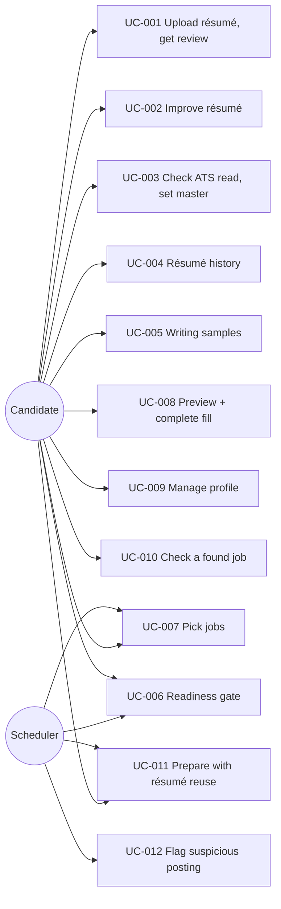

# Use cases
Onboarding & profile (Feature lane 2026-10-04). Status in trace.yaml. Actor = candidate unless noted.

What to notice: scheduler touches only the gate and job selection; every other step is the candidate's choice.
UC-006 sits in front of all apply paths, manual or scheduled.

### UC-001 Upload résumé, get review
REQs: REQ-093, REQ-094 · Pre: `careeros init` done · Trigger: drop file on Profile › Résumés
Main: 1 validate type/size 2 store v1 author=user (read-only original) 3 convert → v2 (REQ-124) 4 start review run on v2 5 workspace shows progress 6 feedback cards beside résumé
Alt: user leaves page → review continues; Résumés row shows "reviewing", reopen shows result
Fail: bad type/size → inline error, nothing stored · `claude` missing/timeout → `failed` + Retry, file kept
Outcome: résumé stored, feedback items open
E2E-001-01: Given fresh profile When upload 1-page PDF Then v1 listed and review result has ≥1 feedback item (fake skill runner).
E2E-001-02: Given upload When file is `.png` Then error shown and `profile/resumes/` unchanged.
E2E-001-03: Given upload When conversion adds a date absent from v1 Then no v2, workspace shows v1 + reason, review runs on v1 text.
E2E-001-04: Given converter drops one v1 line When workspace opens Then "Not carried over" lists it; Restore adds it to draft.

### UC-002 Improve résumé
REQs: REQ-095, REQ-096, REQ-097 · Pre: UC-001 done · Trigger: Apply / Comment / Edit on a résumé
Main: hover card → quote highlighted · Accept → guarded rewrite replaces quote in draft (inline diff) · Reject · Revert from History · Edit in place → draft (autosaved) · Next/Done → one vN+1, per-change authors (REQ-125, REQ-126)
Fail: guard finds new number/employer/tool → version not created, item shows reason
Outcome: new version, provenance recorded
E2E-002-01: Given item When Accept + Done Then one new version, change tagged ai, inline diff shown, item `applied`.
E2E-002-05: Given 2 accepts + 1 edit When Done Then exactly one new version; Revert of 1 accept before Done leaves its text unchanged.
E2E-002-06: Given draft When page reloaded or "← Résumés" Then Profile row shows "Draft"; reopen restores draft + History.
E2E-002-07: Given 4 items, 2 handled When "Next: Saved answers" Then one version, résumé master, Saved answers opens, 2 items still open.
E2E-002-02: Given AI rewrite adding "40%" absent from v1 When guard runs Then no v2, item open with reason.
E2E-002-03: Given v2 When manual edit + Done Then v3 author=user.
E2E-002-04: Given v1 "supported migration" When rewrite says "led migration" Then no v2, item open with reason.

### UC-003 Check ATS read, set master
REQs: REQ-098, REQ-099 · Trigger: open ATS view / "Make master"
Main: ATS view: text + fields + warnings · Make master → old master → `variant` → master.yaml diff proposed → user approves → written atomically
Alt: user rejects diff → master flag set, master.yaml untouched, readiness item stays open
Fail: extraction finds no text → warning, Make master still allowed, diff empty
E2E-003-01: Given same PDF twice When ATS view Then identical output.
E2E-003-02: Given A master When mark B master Then A=`variant`, diff proposed, master.yaml unchanged until approve.

### UC-004 Résumé history
REQs: REQ-100 · Trigger: open résumé
Main: list résumés → versions (author, time, source) → open any → delete old version
Fail: delete latest master version / master résumé → refused with reason
E2E-004-01: Given v1..v3 When delete v2 Then v1,v3 remain; delete v3 of master refused; delete v1 (original) refused.
E2E-004-02: Given v2,v3 When open v3 in version history + "Show changes" Then removed text struck through, added text in AI colour; "Restore this version" makes it the draft.

### UC-005 Writing samples
REQs: REQ-101 · Trigger: upload/remove on Profile › Writing samples
Main: store sample → learn-voice runs in background → list updated → future cover letters `voice_verified: true`
Alt: remove last sample → learned style cleared, `voice_verified: false`
Fail: learn-voice fails → sample kept, banner + Retry
E2E-005-01: Given 0 samples When upload 2 Then learn-voice called once, list shows 2.

### UC-006 Readiness gate
REQs: REQ-102, REQ-103 · Actor: candidate, scheduler · Trigger: open Today/Profile; any apply path
Main: checklist computed → items with links → all must-haves done → "Ready to apply", apply enabled
Fail: must-have open → apply refused (CLI exit 7, UI disabled with reason, scheduled apply skipped + Action Item once)
E2E-006-01: Given no master résumé When `careeros run apply --job X` Then exit 7 listing "master résumé".
E2E-006-02: Given all must-haves done When GET /api/readiness Then `ready: true`.

### UC-007 Pick jobs
REQs: REQ-104 · Actor: candidate; scheduler reads selection · Trigger: Jobs list checkboxes
Main: scout adds jobs unticked → scored → user ticks some (bulk ok) → prepare/apply runs take only ticked
Alt: untick mid-run → current step finishes, no later stage
E2E-007-01: Given 10 jobs, 3 ticked When `run prepare` Then exactly those 3 prepared.
E2E-007-02: Given ticked job When untick Then `tick` never schedules it.

### UC-008 Preview + complete fill
REQs: REQ-105, REQ-106 · Pre: job prepared, ready (UC-006) · Trigger: "Preview fill" on job
Main: plan table → edit values → unknown fields asked (fill/skip optional) → save-to-profile per answer → Fill
Alt: CLI/scheduled run hits unknown field → Action Item, job paused
Fail: required field skipped → Fill disabled · legal/salary/EEO unanswered → existing pause (REQ-030)
E2E-008-01: Given plan When edit "Notice period" + Fill Then fill_summary read-back = edited value.
E2E-008-02: Given unknown required field When answered with save on Then standard_answers has it, next plan auto-fills.

### UC-009 Manage profile
REQs: REQ-107 · Trigger: open Profile
Main: sections résumés, samples, saved answers (view/edit/delete), learned (lessons, voice), readiness
Fail: YAML write fails → error, file unchanged (atomic)
E2E-009-01: Given 12 saved answers When delete one Then YAML has 11 and next plan no longer uses it.

### UC-010 Check a found job
REQs: REQ-114, REQ-115, REQ-116, REQ-111 · Trigger: Jobs › Check a job
Main: 1 paste/upload JD 2 scan (REQ-109) 3 fit + per-résumé match 4 best ≥ threshold → "use this résumé"
Alt: none ≥ threshold → offer tailor → result ≥ threshold → use it
Fail: tailored still below → notice X/Y + missing skills → ask keep closest; bad file → inline error
Outcome: job stored with chosen résumé or `below_threshold` attempt
E2E-010-01: Given 2 résumés scoring 82/55, threshold 70 When check pasted JD Then 82 résumé marked best, "Why this score" lists matched ✓ / missing (required vs preferred); When Prepare application Then one prepare run starts (job ticked); When Cancel Then no run, job unticked.
E2E-010-02: Given all résumés < 60 and fake tailor returning 64 When check Then notice "64/70" and Yes keeps attempt flagged `below_threshold`.

### UC-011 Prepare with résumé reuse
REQs: REQ-112, REQ-113 · Trigger: `run prepare` on selected jobs
Main: 1 score existing résumés 2 best ≥ threshold → reuse 3 else tweak if gain ≥ min 4 else full tailor
Outcome: fewest new résumés; reason logged per job
E2E-011-01: Given 5 similar jobs and variant scoring ≥ 70 on all When `run prepare` Then 0 tailor skill calls, 5 jobs link the variant.

### UC-012 Flag suspicious posting
REQs: REQ-108, REQ-109, REQ-110 · Trigger: posting stored (scout, check, import)
Main: 1 scan 2 hit → flag + Action Item + badge 3 user reviews → "I checked it" → prepare allowed
Fail: artifacts with untrusted contact info/URLs → QA hard fail
Outcome: injected instructions never acted on
E2E-012-01: Given recorded posting with hidden "ignore previous instructions" When scouted Then flagged and `run prepare --job X` exits 2 until cleared.
E2E-012-02: Given fake tailor output containing an unknown URL When qa runs Then hard fail `untrusted_content`.

### UC-013 Start pipeline with a stop point per job
REQs: REQ-117, REQ-118, REQ-120 · Pre: jobs ticked (UC-007) · Trigger: Jobs list "Start pipeline"
Main: 1 review sheet lists ticked jobs, "Go as far as" Fill for all 2 user changes some rows 3 caps shown with reasons 4 Start → batch → progress
Alt: readiness open → fill/submit rows capped at Prepare; flagged posting → excluded
Fail: client asks Submit for Tier A or Fill/Submit for LinkedIn Easy Apply → server lowers it, reason logged
Outcome: each job goes exactly as far as chosen, never past the safety caps
E2E-013-01: Given ticked jobs (Tier A, LinkedIn Easy Apply, LinkedIn-found with ATS URL, plain) When start with default Fill and plain=Submit Then Tier A filled, Easy Apply prepared, LinkedIn-found filled, plain submitted only if auto-submit verdict allows.
E2E-013-02: Given `POST /api/batches` with stops {tierA: submit} When run Then Tier A never submitted, reason in batch file.

### UC-014 First run and next step
REQs: REQ-119, REQ-121, REQ-131 (REQ-122 deprecated, DEC-022) · Trigger: first UI open; Today page
Main: 1 tour runs once 2 user skips or finishes 3 Today shows setup card until done, then Top picks (UC-015) 4 one click goes there
Alt: Settings "How to use" restarts the tour
Outcome: new user always sees one clear next action
E2E-014-01: Given fresh data dir When open UI, finish tour, reload Then no tour; `data/ui_state.json` tour_done true.
E2E-014-02: Given readiness done and 0 ticked jobs When open Today Then no setup card, no next-step card; Top picks band (or its empty state) first. (amended 2026-10-13)

### UC-015 Prepare a top pick from Today
REQs: REQ-127, REQ-130, REQ-131, REQ-114 · Actor: candidate · Trigger: open Today
Main: 1 setup card while a must-have is open 2 Top picks: 3–5 new best-fit jobs, fit + reasons 3 Prepare → job ticked, one-job prepare run 4 job moves to Jobs › Saved; Needs you gets "Review documents" when ready
Alt: Skip → card gone + Undo · no picks → empty state + "Find jobs now" · no preferences → button to preferences
Fail: prepare fails → card keeps job, cause + one fix · no master résumé → Prepare disabled, reason + link
Outcome: first job prepared from Today without visiting Jobs
E2E-015-01: Given setup done, 6 new scored jobs (1 skipped, 1 Saved) When open Today Then 4 pick cards, best fit first, no setup card.
E2E-015-02: Given a pick When Prepare Then job `selected`, one prepare run for that job, card "Preparing…".
E2E-015-03: Given a pick When Skip then Undo Then card back, status unchanged.
E2E-015-04: Given prepare run failed When open Today Then card shows cause + Retry; Retry starts a new run.
E2E-015-05: Given 2 of 5 must-haves done When open Today Then setup card first, ring 2/5, one primary button.

### UC-016 Track jobs in Jobs
REQs: REQ-072, REQ-128, REQ-129, REQ-130, REQ-132 · Actor: candidate · Trigger: nav Jobs; old `/pipeline` link
Main: 1 Recommended tab, List view, detail right 2 Save → Saved (n) 3 Saved: Start pipeline (REQ-117) 4 applied jobs → Applied tab, stage sub-tabs 5 Board view shows them by stage
Alt: Table view (REQ-120) · phone: list, job opens full page
Outcome: found, saved and applied jobs in one place; no Pipeline page
E2E-016-01: Given any state When open `/pipeline` Then URL `/jobs?tab=applied&view=board`.
E2E-016-02: Given List view When click a job Then URL `/jobs/:id`, detail pane shows it; reload keeps it.
E2E-016-03: Given 3 ticked, 2 applied (1 interview) When open `/jobs` Then Saved (3), Applied (2), Interview (1).
E2E-016-04: Given view Table When reload Then Table still selected.
E2E-016-05: Given a Needs-you job and a Saved job When shown Then amber dot + "Needs you" + amber stripe; grey dot + "Saved", no stripe.
### UC-017 Score a large backlog within budget
REQs: REQ-133, REQ-134, REQ-135, REQ-136, REQ-137 · Actor: candidate; scheduler · Trigger: scan stores many jobs
Main: 1 scout stores jobs, each gets a quick match 2 scheduled score run takes top `per_scan` by quick match, fresh first 3 run stops at per-scan or daily cap 4 scored jobs appear in Recommended 5 rest stay in Not scored with a reason
Alt: candidate opens Not scored → Score now on one or many · daily cap hit → resumes next day
Failure: score call fails → job stays queued, run stops after `max_consecutive_failures` (existing runs config)
Outcome: best jobs scored first; plan quota bounded; nothing hidden
E2E-017-01: Given 10 new jobs When scout stores them Then each has a prescore and no headless call ran.
E2E-017-02: Given queue of 5 (2 stale), per_scan 3 When score run Then the 3 freshest-highest scored, stale ones last.
E2E-017-03: Given per_day reached When scheduled score run Then 0 scored, message "daily scoring limit reached", exit 0.
E2E-017-04: Given unscored job When Score now Then it is scored, not ticked, shows in Recommended.
E2E-017-05: Given 4 unscored When open `/jobs?tab=notscored` Then tab count 4, cards show "Quick match" + reason + Score now.
