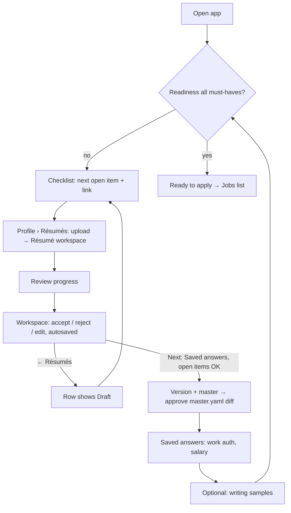
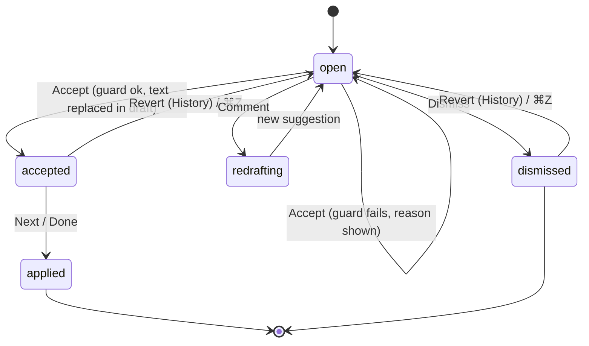
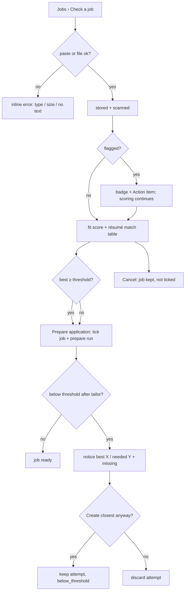
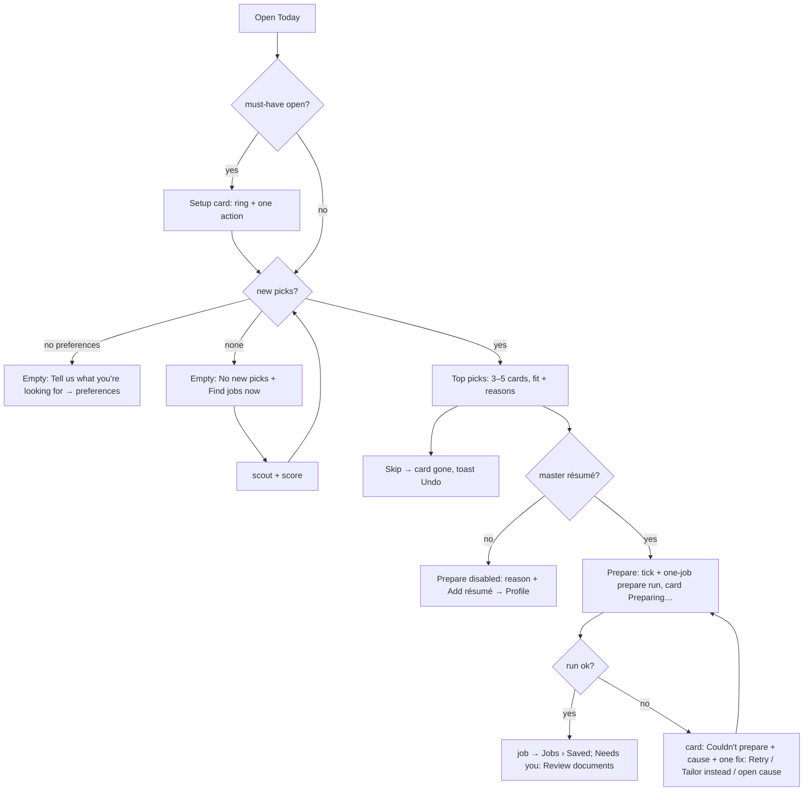

# User flows
Only flows with branching or state. Status in trace.yaml.

### FLOW-001 First run to ready
UCs: UC-001, UC-002, UC-003, UC-005, UC-006

What to notice: the checklist is the hub; every step returns to it, so a user who leaves mid-way resumes at the next open item.

### FLOW-002 Feedback item lifecycle
UCs: UC-002

What to notice: `accepted` lives only in the autosaved draft (REQ-126); Next/Done turns every accepted card into `applied` in one version. `open` items survive Next, so partial review is fine.
What to notice: nothing reaches the résumé except via `applied`, and only after the zero-fabrication guard.

### FLOW-003 Check a job
UCs: UC-010

What to notice: max one tailor run per check; a flagged posting is still scored but can't be prepared until cleared.

### FLOW-004 Select jobs → start pipeline
UCs: UC-007, UC-013, UC-016
```mermaid
flowchart TD
  A[Jobs › Saved tab] --> B[filter / sort optional]
  B --> C[tick jobs: row, select visible, bulk]
  C --> D[Start pipeline]
  D --> E[Review sheet: one 'Go as far as' for all (default Fill, I submit), override per row: Prepare / Fill / Submit]
  E --> F{readiness ok for fill/submit?}
  F -- no --> F1[those rows capped at Prepare, reason + link to Profile]
  F -- yes --> G
  F1 --> G[Start] --> H[Progress: per-job stage, Pause / Cancel / Retry]
  H --> I[done: Prepared / Filled (open tab) / Submitted / Needs you]
```
What to notice: one entry point (Start pipeline on Jobs › Saved, DEC-022); stop stage chosen per job; Tier A never offered Submit, LinkedIn Easy Apply capped at Prepare (LinkedIn-found jobs on a company ATS follow the chosen stop), flagged postings excluded.

### FLOW-005 Today → prepare a top pick
UCs: UC-015, UC-016

What to notice: every dead end has one button (preferences, Find jobs now, Add résumé, Retry). Setup open never hides picks; it only blocks fill/submit (REQ-103), not prepare.
### FLOW-006 Score an unscored job
UC-017 · Start: Jobs › Not scored
1 card shows Quick match + reason 2 Score now → button becomes "Scoring…" (run in Runs) 3 done → toast "Scored 78 · see in Recommended" with link; card leaves tab
Failure: run fails → card shows "Scoring failed · Retry" + Runs link; daily cap does not block Score now (P-ids: P3 feedback, P9 recovery)
